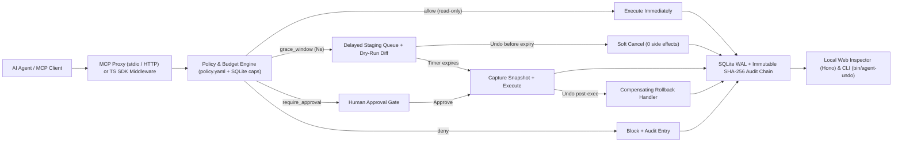

# agent-undo

> Open-source transactional firewall, MCP proxy, and undo/grace-period safety layer that sits between AI agents and external tools/APIs.

`agent-undo` prevents irreversible AI agent mistakes before—and after—they happen. It intercepts every tool call via an MCP proxy (stdio or HTTP) or TypeScript SDK middleware, evaluates deterministic YAML/JSON policies and spend/mutation budgets, renders human-readable dry-run diffs, holds risky actions inside a cancelable grace window or approval gate, captures pre-execution snapshots for compensating rollbacks, and writes an immutable SHA-256 hash-chained audit log in local SQLite.

Runs **100% locally** out of the box on Node.js 22+ with **zero external API keys**.

---

## Architecture



```
+-------------------+      +-------------------------------+      +---------------------------+
| AI Agent / Client | ---> | MCP Proxy (stdio / POST /mcp) | ---> | Policy & Budget Engine    |
+-------------------+      | or wrapTool() TS Middleware   |      | allow | grace | approve | |
                           +-------------------------------+      | deny  | session/daily cap |
                                                                  +-------------+-------------+
                                                                                |
                       +--------------------------------------------------------+
                       v                                                        v
        +------------------------------+                         +----------------------------+
        | Delayed Grace Queue / Gate   | --(Snapshot + Execute)->| External Tools / Adapters  |
        | (Dry-Run Diff + Soft Cancel) | <-(Compensate Rollback)-| Gmail, Calendar, Stripe,FS |
        +--------------+---------------+                         +----------------------------+
                       |
                       v
        +---------------------------------------------------------+
        | SQLite Persistence (actions, snapshots, SHA-256 audit)  |
        | Served via Local Web Inspector (http://127.0.0.1:4310)  |
        +---------------------------------------------------------+
```

---

## Quickstart

### 1. Install & Build

```bash
npm install
npm run build
```

### 2. Run the End-to-End Local Demo

`npm run demo` uses built-in local mock adapters (Gmail, Google Calendar, Stripe, and sandboxed Filesystem) to demonstrate read-only pass-through, grace-window soft-undo, snapshot compensating rollback, approval gating, `.env` rule denial, session spend cap blocking, MCP proxy self-undo, and SHA-256 audit chain verification:

```bash
npm run demo
```

### 3. Launch the Local Web Inspector & REST API

```bash
./bin/agent-undo start
```

Open `http://127.0.0.1:4310` in your browser to view:
- Live grace-window countdown bars and colorized unified dry-run diffs
- 1-click **Undo (Cancel)**, **Approve & Execute**, and **Rollback (Compensate)** buttons
- Real-time Session & Daily spend/mutation meters
- Interactive playground presets to test every firewall decision path
- Mock world state (emails, calendar events, Stripe charges, sandbox files)
- Tamper-evident SHA-256 hash-chained audit log

---

## CLI Reference

```bash
# Start local inspector, REST API, HTTP MCP endpoint (/mcp), and grace scheduler
agent-undo start [--port 4310] [--host 127.0.0.1] [--db .agent-undo/state.db] [--policy policy.yaml]

# List staged grace-window and pending-approval actions + current budget meters
agent-undo queue [--session default] [--all] [--json]

# Soft-cancel a pending action OR trigger compensating rollback on an executed action
agent-undo undo <action-id> [--actor cli] [--server-url http://127.0.0.1:4310]

# Approve and execute a pending_approval action
agent-undo approve <action-id> [--actor cli] [--server-url http://127.0.0.1:4310]

# Inspect and cryptographically verify the immutable SQLite audit log
agent-undo audit [--limit 50] [--verify] [--json]

# Run as an MCP stdio proxy (with built-in tools or wrapping any upstream MCP stdio server)
agent-undo mcp [--grace-mode receipt|wait] [-- <upstream-cmd> <args...>]
```

---

## Integration Modes

### Mode A: MCP Proxy (Stdio & HTTP)

Wrap any existing MCP stdio server so every `tools/call` passes through `agent-undo` without modifying the upstream server:

```bash
./bin/agent-undo mcp --policy policy.yaml -- node path/to/your-mcp-server.js
```

Or connect any HTTP-capable MCP client to `http://127.0.0.1:4310/mcp` (pass `Mcp-Session-Id` header for per-session budget tracking).

The proxy automatically exposes two firewall meta-tools to the agent:
- `agent_undo_undo`: Lets the agent cancel its own staged grace-window call or trigger a compensating rollback (`{ actionId }`).
- `agent_undo_status`: Lets the agent check active staged actions and remaining budgets (`{ sessionId? }`).

### Mode B: TypeScript SDK Middleware

```ts
import {
  createFirewall,
  wrapTool,
} from 'agent-undo';

const { db, engine } = createFirewall({
  dbPath: '.agent-undo/state.db',
  policyPath: 'policy.yaml',
});

const sendWebhook = wrapTool(
  engine,
  {
    name: 'webhook.dispatch',
    description: 'Send webhook payload',
    previewDiff: (args) => ({
      title: `POST webhook to ${args.url}`,
      operation: 'send',
      target: String(args.url),
      before: null,
      after: args.body,
      unifiedDiff: `+ POST ${args.url}\n+ ${JSON.stringify(args.body)}`,
      reversible: false,
      reversibilityNote: 'Soft-undoable only during grace window.',
    }),
    execute: async (args: { url: string; body: Record<string, unknown> }) => {
      // Perform side effect
      return { delivered: true, url: args.url };
    },
  },
  { sessionId: 'agent-run-42', agentId: 'planner' },
);

const outcome = await sendWebhook({ url: 'https://example.local/hook', body: { ok: true } });
if (outcome.status === 'staged') {
  // Cancel before grace window expires:
  await engine.undo(outcome.action.id, 'operator');
}
```

---

## Policy Configuration Reference (`policy.yaml`)

Rules are evaluated **top-to-bottom** (first match wins). Policies may be authored in YAML or JSON.

```yaml
version: "0.1"
defaultDecision: require_approval # allow | grace_window | require_approval | deny
defaultGraceSeconds: 30

budgets:
  session:
    maxSpendUsd: 100
    maxMutations: 25
  daily:
    maxSpendUsd: 500
    maxMutations: 100

rules:
  - id: deny-sensitive-files
    match:
      tool: ["fs.read_file", "fs.write_file", "fs.delete_file"]
      args:
        path:
          regex: "(^|/)(\\.env(\\..*)?|\\.ssh(/|$)|id_rsa|etc/passwd)"
    decision: deny
    reason: "Sensitive credential paths are blocked."

  - id: allow-read-only
    match:
      tool: ["*.list_*", "*.get_*", "*.read_*", "fs.list_dir"]
    decision: allow
    readOnly: true

  - id: require-approval-large-charge
    match:
      tool: "stripe.create_charge"
      args:
        amountCents:
          gte: 5000
    decision: require_approval
    spendExtractor:
      arg: amountCents
      scale: 0.01
```

### Supported `args` Predicate Operators
- Primitive shorthand (`args: { permanent: true }`)
- `eq`, `neq`
- `gt`, `gte`, `lt`, `lte`
- `in` (array membership)
- `contains` (substring or array element)
- `regex` (ECMAScript regular expression)
- Nested dot-paths (`args: { "options.permanent": true }`)

### Budget & Reservation Semantics
- Read-only `allow` actions (`readOnly: true`) consume **0 mutations** and **$0 spend**.
- Actions in `grace_pending`, `pending_approval`, `approved`, `executing`, and `executed` count toward active session and daily caps so concurrent burst calls cannot bypass limits.
- Soft-canceling (`undone`) or rolling back (`rolled_back`) an action immediately frees its spend and mutation budget.

---

## Reversibility Matrix (Built-in Demo Adapters)

| Tool | Policy Default | Grace Soft-Undo | Post-Execution Compensating Rollback |
| --- | --- | --- | --- |
| `gmail.list_messages` | `allow` | N/A (read-only) | N/A (read-only) |
| `gmail.send_email` | `grace_window` (30s) | Cancels before delivery | Irreversible once sent (throws `IrreversibleActionError`) |
| `gmail.delete_email` | `grace_window` / `require_approval` | Cancels before delete | Restores exact message row and folder from snapshot |
| `calendar.list_events` | `allow` | N/A (read-only) | N/A (read-only) |
| `calendar.create_event` | `grace_window` (30s) | Cancels before creation | Deletes created event |
| `calendar.cancel_event` | `grace_window` (30s) | Cancels before cancellation | Restores original confirmed status |
| `stripe.list_charges` | `allow` | N/A (read-only) | N/A (read-only) |
| `stripe.create_charge` | `grace_window` (< \$50) / `require_approval` (>= \$50) / `deny` (> \$1,000) | Cancels before charging | Issues automatic refund (`re_...`) and releases spend cap |
| `stripe.refund_charge` | `require_approval` | Cancels before refunding | Irreversible once refunded |
| `fs.list_dir`, `fs.read_file` | `allow` (`.env`/`.ssh` denied) | N/A (read-only) | N/A (read-only) |
| `fs.write_file` | `grace_window` (30s) | Cancels before writing | Restores previous file bytes or removes newly created file |
| `fs.delete_file` | `require_approval` | Cancels before unlinking | Recreates deleted file from snapshot |

---

## Development & Verification

```bash
npm run build      # Compile TypeScript to dist/
npm run typecheck  # Strict tsc --noEmit across src, test, and scripts
npm run lint       # ESLint check
npm test           # Run full Vitest unit & integration suite
npm run demo       # Run deterministic end-to-end showcase
```

## License

[MIT](./LICENSE)
